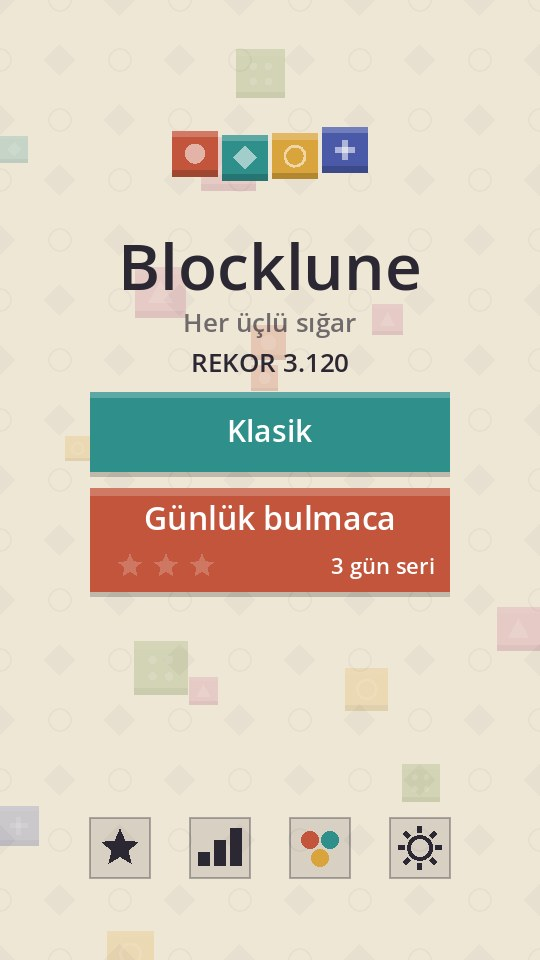
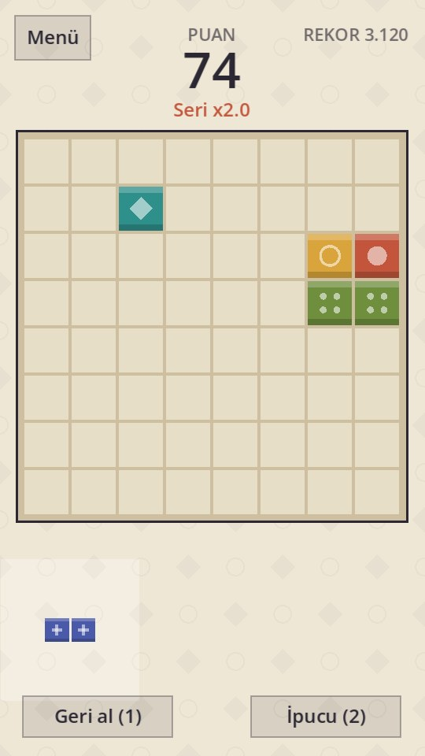
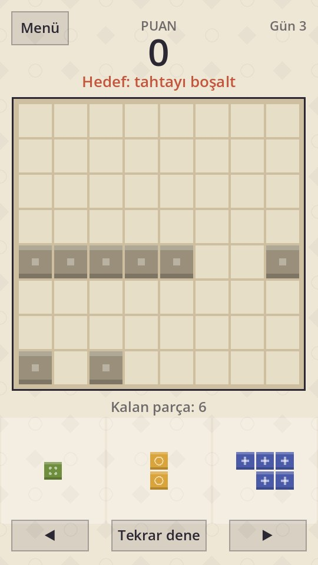
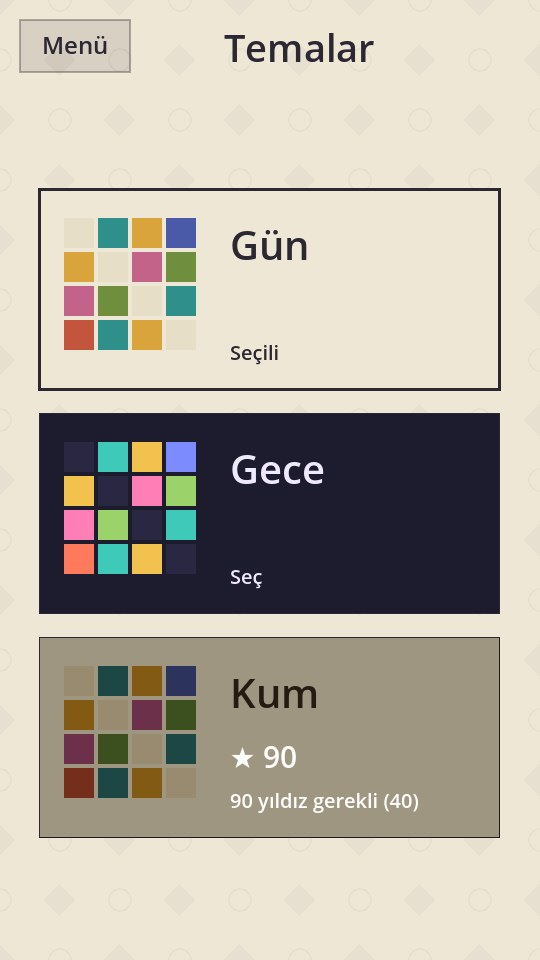

# Blocklune: Block Puzzle

A calm, offline block puzzle for Android: place three pieces on an 8×8 board, fill rows or columns to clear them and build streaks. Every new set of pieces is chosen so that it fits on the board in some order — you only get stuck by your own placements.

[Türkçe](#türkçe) · [Privacy policy](privacy.md)

  
  
  
  

## Download

- **Android:** coming to Google Play.

## Features

- **No unfair losses:** every set of three pieces fits on the current board in some order.
- **Classic:** endless play, best score and a chart of your last 10 games.
- **Daily puzzles:** 400 hand-verified puzzles; clear the board, reach a score or clear lines.
- **3 themes** (Day, Night, Sand), **24 achievements** and a daily streak.
- Undo, hints and a "Second Wind". Color-blind friendly: every color has its own pattern.
- English and Turkish. Fully offline.

The game is free. It shows ads from Google AdMob only after a Classic game ends (never while you play, never on the daily puzzle, never in the first 15 minutes or first 5 games). Rewarded ads are optional: for a second chance after a game, or for extra Undo/Hint uses once the free ones run out. A one-time purchase ("Remove ads") turns ads off for good. Intended for ages 13 and over.

## Support

luneapps.support@gmail.com

Built with Godot Engine (MIT license).

This repository holds the documentation only; the source code is not published here.

---

## Türkçe

# Blocklune: Blok Bulmaca

Android için sakin, internetsiz bir blok bulmacası: 8×8 tahtaya gelen üç parçayı yerleştir, satır ya da sütunu doldurup sil, seri yap. Her yeni parça takımı, tahtaya bir sırayla sığacak şekilde seçilir; oyun ancak kendi yerleştirmelerinle tıkanır.

## İndir

- **Android:** Google Play'e geliyor.

## Özellikler

- **Haksız kayıp yok:** her üçlü parça, tahtanın o anki haline bir sırayla sığar.
- **Klasik:** sınırsız oyun, rekor ve son 10 oyun grafiği.
- **Günlük bulmaca:** 400 elle doğrulanmış bulmaca; tahtayı boşalt, puan topla ya da çizgi sil.
- **3 tema** (Gün, Gece, Kum), **24 başarım** ve günlük seri.
- Geri al, ipucu ve "Bir şans daha". Renk körü dostu: her renkte ayrı bir motif.
- Türkçe ve İngilizce. Tamamen internetsiz çalışır.

Oyun ücretsizdir. Google AdMob reklamlarını yalnızca Klasik oyun bittikten sonra gösterir (oyun sırasında asla, günlük bulmacada asla, ilk 15 dakika ve ilk 5 oyunda asla). Ödüllü reklam isteğe bağlıdır: oyun bitince bir şans daha ya da ücretsiz Geri al/İpucu hakların bitince ek hak için. Tek seferlik bir satın almayla ("Reklamları kaldır") reklamlar kalıcı olarak kapanır. 13 yaş ve üzeri için tasarlanmıştır.

## Destek

luneapps.support@gmail.com

Godot Engine (MIT lisansı) ile yapıldı.

Bu depoda yalnızca belgeler bulunur; kaynak kod burada yayımlanmaz.
